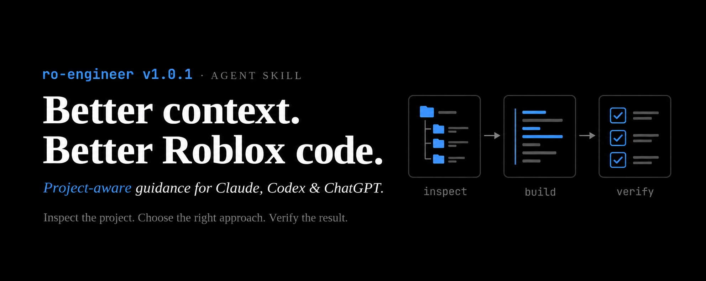

<p align="center">
  
</p>

# ro-engineer v1.0.1

Project-aware Roblox/Luau engineering for Claude Code, Codex, and supported
ChatGPT environments. Inspect existing systems, choose architecture that fits,
protect server boundaries, and validate actual behavior. Optional game-design
references cover loops, onboarding, economy, and fair retention.

One canonical `SKILL.md` routes to focused references. Small fixes need no
mandatory design document; ECS and pooling are conditional choices. The skill
does not install libraries, connect MCP, or grant Roblox Studio access.

## Install and use

| Platform | Installation | Verify / invoke |
|---|---|---|
| Claude Code plugin | `/plugin marketplace add excaldev/ro-engineer`, then `/plugin install ro-engineer@ro-engineer` | Find it in `/plugin`; invoke `/ro-engineer:ro-engineer` |
| Claude standalone | Extract the skill folder into `.claude/skills/` (project) or `~/.claude/skills/` (personal) | Look in the `/` menu; invoke `/ro-engineer` |
| Codex | Extract into `.agents/skills/` (project) or `~/.agents/skills/` (personal) | Find it in the skills list; invoke `$ro-engineer` |
| ChatGPT | Use a supported desktop skill/import flow or the generated plugin package where custom plugin upload is enabled | Confirm in Skills/Plugins and select it with `@` |

Use the complete `ro-engineer/` folder, including references, workflows,
templates, and metadata. Root-level `SKILL.md` in an ordinary project is not
a universal Codex installation. Use the [v1.0.1 release](https://github.com/excaldev/ro-engineer/releases/tag/v1.0.1):

- [Standalone skill ZIP](https://github.com/excaldev/ro-engineer/releases/download/v1.0.1/ro-engineer-skill-v1.0.1.zip): Claude standalone, Codex, and supported setup import.
- [OpenAI plugin ZIP](https://github.com/excaldev/ro-engineer/releases/download/v1.0.1/ro-engineer-openai-plugin-v1.0.1.zip): supported ChatGPT custom-plugin installation.
- [Download checksums](https://github.com/excaldev/ro-engineer/releases/download/v1.0.1/SHA256SUMS.txt): verify that downloaded files match the release packages.

See [installation and platform support](docs/installation.md) for requirements,
manual paths, installer options, updates, uninstall, availability limits,
Claude chat upload, and source links.

### ChatGPT installation

**Plugin route:** download the OpenAI plugin ZIP above. Where your account or
workspace enables custom plugin ZIP uploads, upload it through that flow,
enable the plugin, and confirm **ro-engineer** appears in Plugins. Start a new
chat and select it with `@`. The package includes the skill and all its references.

**Desktop setup import:** if you already use a supported Claude setup, install
the standalone skill in its Claude skills folder, then open ChatGPT desktop
**Settings > Import**, select that source agent, and include Skills. Review the
import and confirm ro-engineer appears in Skills before selecting it with `@`.

These routes depend on your client and workspace permissions. Copying files
into a Codex folder or attaching a ZIP to an ordinary chat is not a universal
ChatGPT installation method. Studio and ROTEX access require separate connected
tools; the skill works with supplied code when those tools are unavailable.
See [OpenAI's skill/import guidance](https://learn.chatgpt.com/docs/build-skills),
[setup import](https://learn.chatgpt.com/docs/import), and
[plugin permissions](https://learn.chatgpt.com/docs/enterprise/apps-and-connectors).

Example requests:

```text
Review this RemoteEvent handler for authorization and duplicate purchases.
Fix the respawn leak using our existing cleanup helper.
Diagnose our projectile bottleneck using the profile and existing architecture.
Design a player loop for this game's audience and prototype scope.
```

## Working modes

Studio MCP enables only its exposed place/script/playtest actions. ROTEX can
supply project/library context and validation when connected. Repository mode
uses local files and configured tooling; offline mode uses supplied code and
provides placement and manual checks. Capabilities can combine and vary by
implementation. See [tool modes](references/tool-modes.md).

## Repository and releases

`SKILL.md`, `references/`, `workflows/`, `templates/`, and `agents/` are the
shared skill. `.claude-plugin/` provides Claude packaging; `packaging/` holds
the portable OpenAI plugin manifest. No copied skill tree is maintained.
Game design stays optional in the same skill because economy and gameplay
engineering overlap; it is not loaded for unrelated code work.

With Python 3.10+ (standard library only), from the repository root:

```sh
python scripts/validate.py
python -m unittest discover -s tests -v
python scripts/package.py
```

The builder emits versioned standalone-skill and OpenAI plugin ZIPs and a
SHA-256 list under ignored `dist/`. It uses explicit file allowlists and portable
ZIP paths. See [release checks](docs/releasing.md). Current platform sources
were checked on 2026-11-01; live imports and account access must be tested
separately. Generated `promo/**/png/` folders are ignored; promotional material
is kept out of the release commit. [Benchmark plan](docs/benchmark.md) defines comparisons without
claiming unmeasured model-quality or speed gains.

## License

[MIT](LICENSE)
