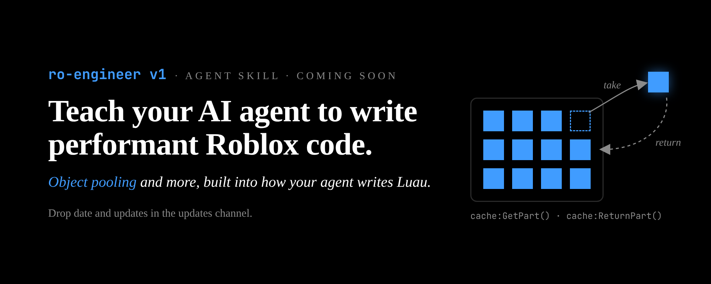

<p align="center">
  
</p>

# ro-engineer

An agent skill that teaches Claude to plan, design and write Roblox games the
way a senior Roblox engineer and game designer would. It designs the player
loop before the systems and the systems before the code, and it writes
modern, strict, performant Luau.

One router (`SKILL.md`) sends the model to small reference files that load
only when needed, so the skill stays cheap on context while covering a lot of
ground.

## What's inside

**Engineering**
- Modern Luau and strict typing (`--!strict`, `export type`, generics, the
  `task` library)
- Pattern selection: plain modules vs. state managers vs. object pooling vs.
  OOP vs. ECS, with decision rules
- Composition in OOP and ECS, a hybrid approach, and a migration path
- Object pooling, state management, cleanup and lifecycle (Trove/Maid)
- Client/server boundaries, remote validation and rate limiting
- Performance auditing, testing, and a severity-rated list of sharp edges

**Game design**
- Game anatomy for today's base-and-collect hits: fantasy, unique mechanic,
  RNG timing, level design, tension, progression and collection
- A dated market snapshot that breaks six hit games down block by block
- Retention psychology mapped to concrete in-game features, with fair vs.
  manipulative versions
- Player incentives, onboarding, progression and economy, live ops

**Workflows**, each with an explicit stop point for approval:

```
plan -> design-game-loop -> design-system -> implement
```

Plus code review, performance, retention and economy audits.

## Install

### Claude Code (plugin, recommended)

```
/plugin install ro-engineer --marketplace excaldev/ro-engineer
```

Or add the marketplace first, then install:

```
/plugin marketplace add excaldev/ro-engineer
/plugin install ro-engineer@ro-engineer
```

### Claude Code (plain skill)

Personal, available in every project:

```bash
git clone https://github.com/excaldev/ro-engineer ~/.claude/skills/ro-engineer
```

Per project (commit it so your team gets it):

```bash
git clone https://github.com/excaldev/ro-engineer .claude/skills/ro-engineer
```

### claude.ai

1. Download `ro-engineer-v1.zip` from the
   [latest release](https://github.com/excaldev/ro-engineer/releases/latest).
2. Upload it under **Settings > Capabilities > Skills** (the location may
   vary by plan).

Skills don't sync across surfaces, so upload again after updating. In chat,
the skill runs in `offline` mode (see below).

## Usage

Invoke it with `/ro-engineer`, or just ask a Roblox question; the skill
triggers on Roblox, Luau and Studio tasks.

```
/ro-engineer design a core loop for a pet-raising game with steal mechanics
/ro-engineer review this projectile module
/ro-engineer my server lags when 30 players fire at once
```

## Modes

The skill detects its environment and adapts:

| Mode | When | Behaviour |
|---|---|---|
| `studio` | Roblox Studio MCP tools available | Reads real scripts, runs Luau, playtests, reads the console |
| `rotex` | ROTEX MCP tools available | Queries existing systems and libraries, validates generated code |
| `offline` | No MCP tools (e.g. claude.ai chat) | Copy-paste-ready modules with placement instructions |

Modes stack: `studio` + `rotex` is common.

## Layout

```
SKILL.md                 router: tool detection, routing table, core rules
references/              one topic per file, loaded only when routed to
workflows/               phased procedures (plan, game loop, system design, implement, audits)
templates/               output skeletons for plans, loop docs, design docs and modules
.claude-plugin/          plugin and marketplace manifests for Claude Code
assets/                  README images
```

## Keep it current

Some content ages quickly. Re-check these periodically:

- Luau features that may have shipped since writing (`const`, new type
  solver behaviour) against the Luau release notes. All experiences share one
  Luau version, so this is about release timing, not per-game versions:
  `references/luau-modern.md`, `references/luau-types.md`.
- Popular-game snapshot (which hits lead the niche and how they work):
  `references/market-references.md`.
- Community library names and maintenance status (ECS, networking, state,
  cleanup, data).
- Roblox policies on paid random items, odds disclosure and time-limited
  offers: `references/player-incentives.md`,
  `references/retention-psychology.md`, `references/progression-economy.md`.

Add real incidents to `references/sharp-edges.md` as you hit them.

## Releasing

Bump `version` in `.claude-plugin/plugin.json`, add a `CHANGELOG.md` entry,
then build the claude.ai zip. The zip must have the skill folder at its root
(`ro-engineer/SKILL.md`):

With `zip` (macOS, Linux, Git Bash with zip installed):

```bash
mkdir -p dist/stage/ro-engineer && cp -r SKILL.md LICENSE references workflows templates dist/stage/ro-engineer/ && (cd dist/stage && zip -r ../ro-engineer-v1.zip ro-engineer) && rm -rf dist/stage
```

On Windows PowerShell, avoid `Compress-Archive`: version 5.1 writes
backslashes into zip paths, which break on other platforms. Use .NET instead:

```powershell
Add-Type -AssemblyName System.IO.Compression, System.IO.Compression.FileSystem
New-Item -ItemType Directory -Force dist | Out-Null
$out = Join-Path (Get-Location) "dist\ro-engineer-v1.zip"; Remove-Item $out -ErrorAction SilentlyContinue
$root = (Get-Location).Path
$files = @(Get-Item SKILL.md, LICENSE) + @(Get-ChildItem references, workflows, templates -Recurse -File)
$zip = [System.IO.Compression.ZipFile]::Open($out, 'Create')
foreach ($f in $files) {
  $rel = $f.FullName.Substring($root.Length + 1).Replace('\', '/')
  [System.IO.Compression.ZipFileExtensions]::CreateEntryFromFile($zip, $f.FullName, "ro-engineer/$rel") | Out-Null
}
$zip.Dispose()
```

## License

[MIT](LICENSE)
