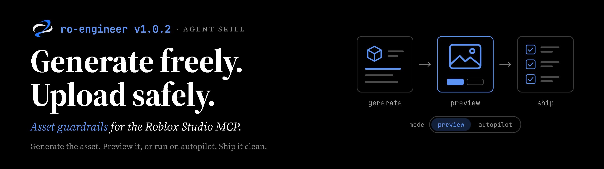

# ro-engineer v1.0.2: asset guardrails for the Studio MCP

**Generate freely. Upload safely.** A light update that teaches ro-engineer how
to work with the asset tools in the Roblox Studio MCP server.

## Why now

The Studio MCP server no longer stops at reading and editing scripts. Agents
connected to it can now generate meshes, materials, procedural models, and
animations; search and insert Creator Store assets; upload images to the
user's Roblox account; and save the place. (Exact tool names and availability
depend on the Studio version; check the
[Studio MCP docs](https://create.roblox.com/docs/studio/mcp).)

That is a real speed-up. A prop pass that used to mean modelling, exporting,
uploading through the Asset Manager, and wiring everything up can now happen
inside one conversation, and new assets reach a playable build in minutes.

It also moves risk onto the account doing the uploading:

- **Uploads are moderated, and enforcement can reach the account.** An image is
  judged on its own, not by the game it's for. One reported case: a developer
  received a one-day suspension for a texture atlas of ordinary environment
  materials that contained a few blood-like stains.
- **Generated output is unreviewed output.** A prompt like "bloody floor" or "in
  the style of [franchise]" can produce content that is moderated, or an IP
  look-alike, without anyone looking at it closely.
- **Free models can carry code.** Inserted assets can contain backdoors,
  `require(assetId)` loaders, or obfuscated scripts.
- **Speed hides mistakes.** An agent that generates, uploads, and saves in one
  run can ship a problem before a person sees it.

## What ro-engineer now does

A new reference, `references/asset-compliance.md`, loads automatically before
any MCP action that generates, inserts, uploads, or saves assets. Script-only
work is unaffected.

- **Preview mode by default.** Assets land in `ServerStorage/_AssetStaging`
  (not replicated, so they never show up in a playtest by accident). The agent
  shows a short card with front, three-quarter, and close-up captures, and waits
  for approve, revise, regenerate, or discard.
- **Autopilot when asked.** Say "autopilot" or "just do it" and the agent keeps
  going without per-asset approval. It runs the same checks, self-corrects
  failing assets (at most two retries), moves anything still failing to
  `ServerStorage/_AssetQuarantine`, and ends with a report.
- **Hard stops in every mode.** The agent always asks before uploading images,
  inserting scripted Creator Store assets, acting on a DO NOT UPLOAD finding,
  using content with unclear rights, saving a cloud place, or deleting your
  existing content. You can pre-approve one kind for a task ("you can upload the
  decals too").
- **Safer prompts at the source.** The agent describes wear as rust, oil, or
  chipped paint, keeps brands, named characters, and text out of generated
  textures, and writes animations in neutral terms.
- **Full inspection.** Every texture map, atlas region, material, particle,
  animation, script, and metadata field is checked, along with how assets look
  once composed in the scene. Anything it can't see properly is listed as
  uninspected, not passed.
- **Clear results.** PASS, REVISE, DO NOT UPLOAD, or NEEDS POLICY CHECK, with
  the component responsible for each finding.

ro-engineer gives a pre-upload risk assessment, not a moderation verdict. It
never claims an asset will pass Roblox moderation.

## Getting it

- **Claude Code plugin:** update through `/plugin`, or reinstall with
  `/plugin install ro-engineer@ro-engineer`.
- **Standalone skill / OpenAI plugin:** use `ro-engineer-skill-v1.0.2.zip` or
  `ro-engineer-openai-plugin-v1.0.2.zip` (see [installation](installation.md)).

The skill installs no MCP connection. Asset guidance applies only where the
Studio MCP server is connected and exposes those tools.

## Also in this release

- `SKILL.md` routes asset work to the new reference.
- A packaging test no longer fails when the repository has a `promo/` folder.
- New README banner and skill logo.

Full list: [CHANGELOG](../CHANGELOG.md).
